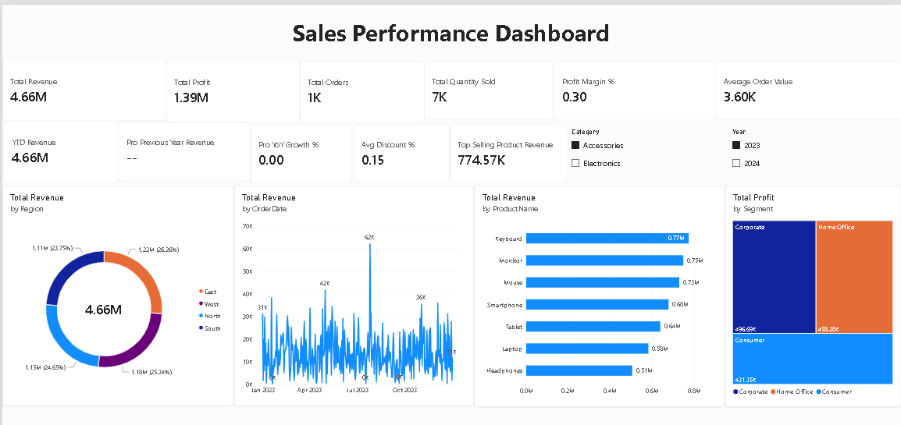
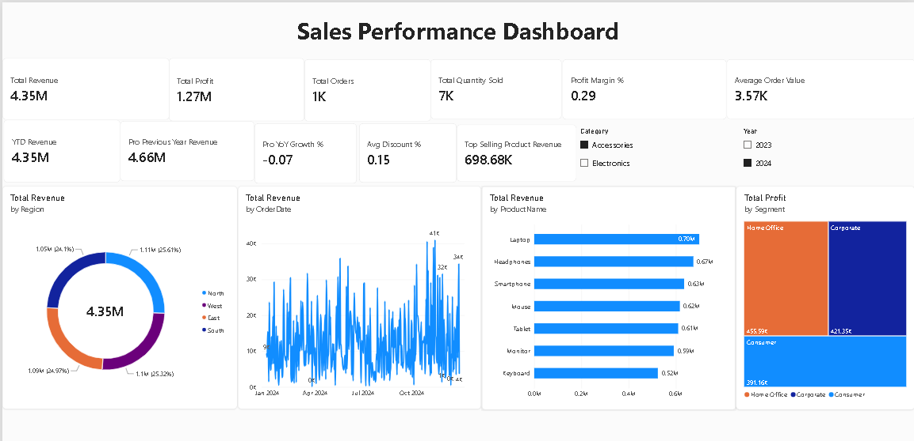
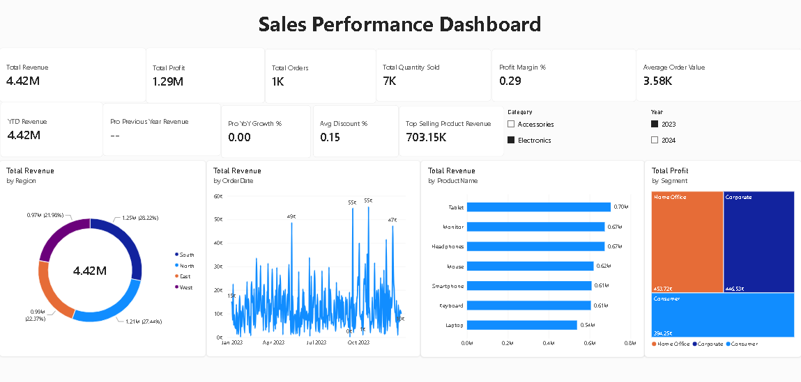
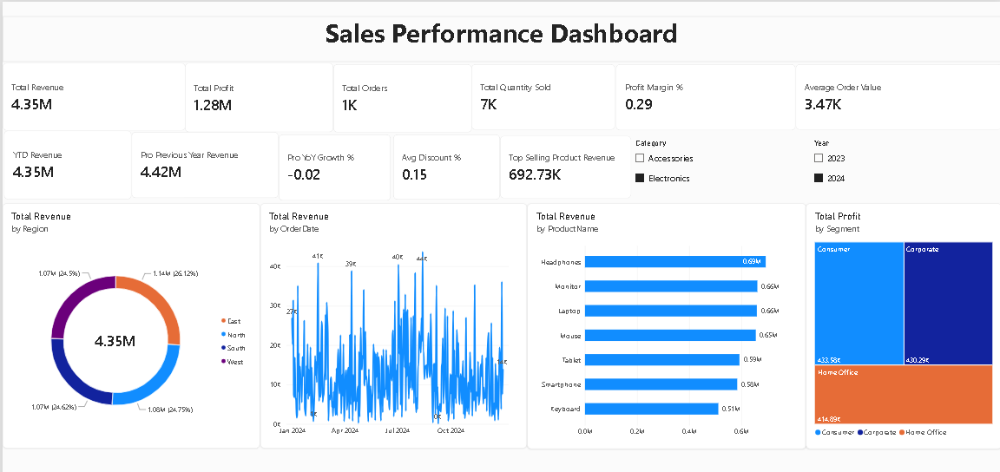

# Sales Performance Dashboard 📊

## Project Overview
This project is an end-to-end **Data Analytics & Business Intelligence** solution designed to analyze sales performance, profitability, and customer segments. The project involves data generation, data structuring via SQL, and an interactive dashboard built in **Power BI**. 

### 🚀 Live Dashboard Features:
- **Core KPIs:** Total Revenue, Profit, Orders, Quantity Sold, Profit Margin, and Average Order Value.
- **Time Intelligence:** Year-to-Date (YTD) Revenue, Previous Year Revenue, and Year-over-Year (YoY) Growth.
- **Product & Customer Analysis:** Top-selling products and Revenue distribution across Regions and Segments.
- **Dynamic Filtering:** Slicers for 'Category' and 'Year' for interactive drill-downs.

---

## 🛠️ Tech Stack & Tools Used
- **Power BI:** Data Modeling, DAX (Data Analysis Expressions), and Data Visualization.
- **SQL:** Data cleaning, transformation, and creating views (Mocked in `schema.sql`).
- **Python:** Standard libraries used for generating realistic dummy datasets (`data_generator.py`).
- **Excel/CSV:** Raw data storage.

---

## 📂 Repository Contents
| File/Folder Name | Description |
| :--- | :--- |
| `Sales Dashboard.pbix` | The final interactive Power BI Dashboard file. |
| `Data/sales_data.csv` | The generated dataset containing 5000 records of raw sales data. |
| `Scripts/data_generator.py` | Python script used to generate the dataset. |
| `Scripts/schema.sql` | SQL queries demonstrating how raw data would be transformed and modeled. |
| `DAX/DAX_Measures.txt` | A compilation of all DAX formulas used to calculate the KPIs in Power BI. |
| `DAX/Pro_DAX.txt` | Advanced DAX formulas including the automated Calendar table. |
| `Assets/` | Contains preview images and screenshots of the dashboard. |

---

## 📸 Dashboard Preview

---

## 💡 Key Learnings & Skills Demonstrated
1. **Data Modeling:** Built a robust data model by connecting a Fact table (`sales_data`) with a Date Dimension table (`Calendar`).
2. **Advanced DAX:** Mastered Time Intelligence functions (`TOTALYTD`, `SAMEPERIODLASTYEAR`) and performance metrics calculation.
3. **UI/UX Design:** Designed a clean, professional, and easily readable interface using visual borders, shadows, and consistent themes.

## 🏃‍♂️ How to Run This Project
1. Download or clone this repository.
2. Ensure you have [Power BI Desktop](https://powerbi.microsoft.com/desktop/) installed.
3. Open the `Sales Dashboard.pbix` file.
4. (Optional) You can explore the `data_generator.py` script to generate a fresh dataset.
